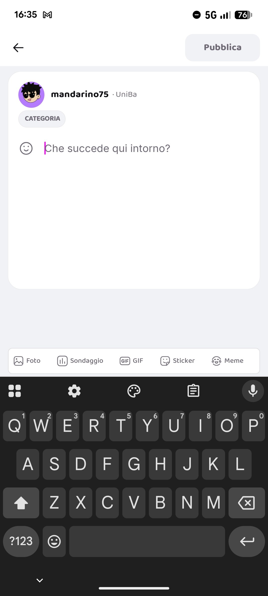
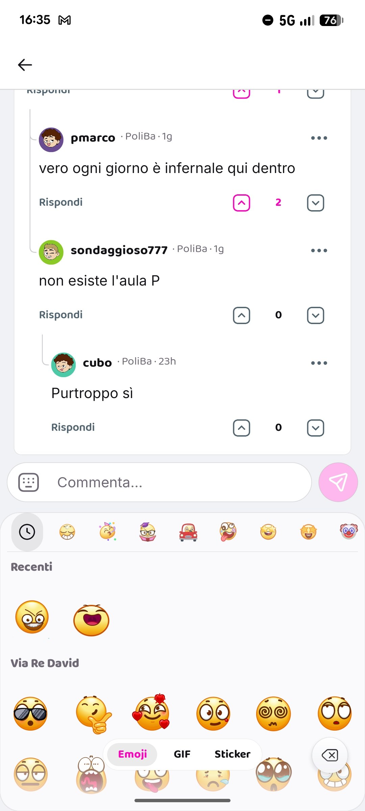

  

<h1 align="center">Axoo</h1>

An anonymous social app for university students.

  <a href="https://play.google.com/store/apps/details?id=com.axoo">Google Play</a>
  ·
  <a href="https://apps.apple.com/it/app/axoo/id6816748869">App Store</a>

  
  

## Code

[Android · Kotlin](axoo-kotlin/README.md) · [iOS · Swift](axoo-ios/README.md) · [Backend · Go](axoo-server/README.md)

## License

Axoo’s original code is licensed under [AGPL-3.0-only](LICENSE).
See the third-party notices for [Android](axoo-kotlin/THIRD_PARTY_NOTICES.md),
[iOS](axoo-ios/THIRD_PARTY_NOTICES.md), and [the backend](axoo-server/THIRD_PARTY_NOTICES.md).
